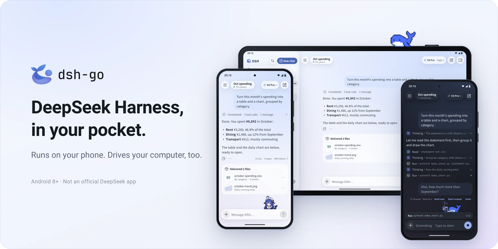
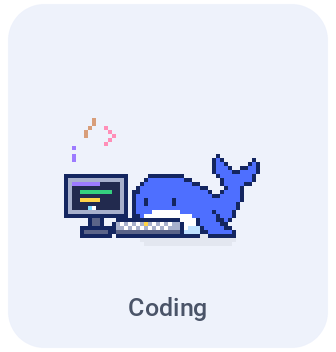
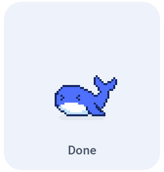
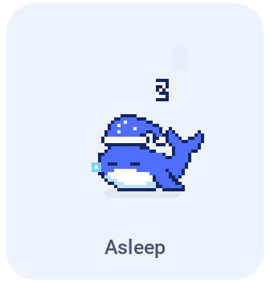

<p align="center">
  <picture>
    <source media="(prefers-color-scheme: dark)" srcset="docs/assets/hero-en-dark.webp">
    
  </picture>
</p>

<p align="center">
  <b>A Native Android Client & Runtime for DeepSeek Harness</b><br>
  Run DeepSeek Harness natively on your phone, or drive remote instances from anywhere.
</p>

<p align="center">
  <a href="https://github.com/patelakash007/DSH-app/releases/latest"></a>
  <a href="https://github.com/patelakash007/DSH-app/releases/tag/v1.0.0"></a>
  <a href="LICENSE"></a>
</p>

<br>

<h3 align="center">Companion Mascots: Deepy & Whale Girl</h3>

<p align="center">They code, flip, wave, and nap alongside your agent tasks, and can even float on your Android home screen.</p>

<p align="center">
  <picture><source media="(prefers-color-scheme: dark)" srcset="docs/assets/pet-deepy-typing-en-dark.gif"></picture>
  <picture><source media="(prefers-color-scheme: dark)" srcset="docs/assets/pet-deepy-happy-en-dark.gif"></picture>
  <picture><source media="(prefers-color-scheme: dark)" srcset="docs/assets/pet-deepy-notification-en-dark.gif"></picture>
  <picture><source media="(prefers-color-scheme: dark)" srcset="docs/assets/pet-deepy-sleeping-en-dark.gif"></picture>
</p>

<p align="center">
  <picture><source media="(prefers-color-scheme: dark)" srcset="docs/assets/pet-girl-typing-en-dark.gif"></picture>
  <picture><source media="(prefers-color-scheme: dark)" srcset="docs/assets/pet-girl-happy-en-dark.gif"></picture>
  <picture><source media="(prefers-color-scheme: dark)" srcset="docs/assets/pet-girl-notification-en-dark.gif"></picture>
  <picture><source media="(prefers-color-scheme: dark)" srcset="docs/assets/pet-girl-sleeping-en-dark.gif"></picture>
</p>

<br>

## Overview

**DSH** is an unofficial native Android client and runtime rewrite for [DeepSeek Harness](https://github.com/deepseek-ai/deepseek-harness). Rebuilt by **patelakash007**, this release transitions the on-device execution model away from heavy container layers to a streamlined, direct **Native Android runtime** powered by the in-process Go engine.

Whether you run DeepSeek models locally on your smartphone or connect remotely to an existing server, DSH provides an intuitive, responsive mobile experience.

---

## Key Features

- **Native On-Device Execution**: Runs directly on Android using native binaries—no PRoot rootfs overhead, no Ubuntu chroot, no separate Termux installation required.
- **Remote Host Management**: Connect seamlessly to remote DSH servers via SSH or the DSH Remote protocol. Switch between local and remote sessions with a single tap.
- **Fluid Turn/Step Interaction**: Steer ongoing replies, queue upcoming messages, respond to interactive tool approvals, and review folded execution traces.
- **Native Flutter & Embedded Web Dual Views**: Toggle dynamically between the native Flutter client interface and the official web interface on the same conversation.
- **Autonomous Phone Control**: With user-granted Accessibility permissions, the agent can inspect the display, navigate apps, and execute automated actions with built-in emergency-stop safeguards.
- **Extensible Plugin Ecosystem**: Rich UI cards, custom tool forms, and slots driven by adapted plugins with full sandboxed isolation.
- **End-to-End Encrypted Sharing**: Share chats as dynamic replay links or visual snapshot cards with client-side cryptographic security.
- **Adaptive Ergonomics**: Tailored layouts for portrait phones, landscape orientations, and tablets. Material You dynamic theming and wallpaper accent matching.

---

## Installation

DSH requires **Android 8.0 (API 26) or later**.

1. Download the release APK from [GitHub Releases](https://github.com/patelakash007/DSH-app/releases/latest). Most modern phones use the **arm64** package.
2. Grant the system permission to install from your browser or file manager.
3. On first launch, select either the **Native On-Device Runtime** or a **Remote Host**.
4. Provide your API credentials for your chosen model provider (e.g., DeepSeek API key) to begin chatting.

---

## Architecture and Repository Structure

| Directory | Description |
|---|---|
| `app/` | Flutter mobile frontend and Android Kotlin platform bridge |
| `packages/dsh_client/` | Pure Dart client for the DSH Web API |
| `packages/dsh_remote/` | Pure Dart client for DSH Remote gateway |
| `native-engine.lock.json` | Pinned revision of the native Go engine (`patelakash007/DSH-go-rewrite`) built into `libdsh.so` |
| `sdk/plugin-kit/` | Native plugin authoring SDK for custom tool widgets and cards |
| `examples/plugins/` | Reference plugins demonstrating forms, slots, and action cards |
| `docs/guide/` | Comprehensive user guides and operational walkthroughs |
| `docs/plugins/` | Plugin developer guides and protocol specifications |
| `tooling/` | Automated build, packaging, and test verification scripts |

---

## Building from Source

Prerequisites: Linux x86_64, JDK 17, Flutter 3.47.7+, Dart `^3.13.5`, Python 3, and standard build utilities.

```bash
# Clone this repository and the pinned native engine
git clone https://github.com/patelakash007/DSH-app.git
cd DSH-app
bash tooling/setup-toolchain.sh
source tooling/env.sh

# Build the Go engine for the APK ABI (Go 1.25.x, Android NDK for x86_64)
git clone https://github.com/patelakash007/DSH-go-rewrite.git ../DSH-go-rewrite
cd ../DSH-go-rewrite
git checkout "$(python3 -c 'import json;print(json.load(open("../DSH-app/native-engine.lock.json"))["revision"])')"
CGO_ENABLED=0 GOOS=android GOARCH=arm64 go build -trimpath -buildvcs=true \
  -o ../DSH-app/app/android/app/src/main/jniLibs/arm64-v8a/libdsh.so ./cmd/dsh-server
cd ../DSH-app

# Record the engine hash/revision the app verifies at launch
python3 tooling/native_engine_manifest.py --lock native-engine.lock.json \
  --binary app/android/app/src/main/jniLibs/arm64-v8a/libdsh.so \
  --abi arm64-v8a --output app/android/app/src/main/assets/runtime/manifest.json

# Build the release APK
bash tooling/build-apk.sh -f arm64 --keep-daemon
```

The output APK is generated at `app/build/app/outputs/flutter-apk/app-arm64-release.apk`. There is no PRoot, Ubuntu rootfs, Node.js, npm or pnpm step: the APK contains only the Go engine and the Flutter UI.

---

## Security and Privacy

- **Direct Model Communication**: Model requests are sent directly to the model provider you configure.
- **Phone Control Guardrails**: Screen content and input events operate under strict permission boundaries. Sensitive actions require explicit interactive confirmation by default.
- **Encrypted Sharing**: Shared links use client-side end-to-end encryption. The decryption key exists solely in the URL fragment and never touches the relay server.

---

## License and Attribution

This project is licensed under the **GNU Affero General Public License v3.0** (AGPL-3.0). Associated SDK tools under `sdk/` and example plugins under `examples/` are licensed under the **MIT License**.

```
Portions of the user interface are derived from the original upstream project by ccch1mneyyy (licensed under AGPL-3.0).
This repository is patelakash007's Native Android rewrite, maintained at https://github.com/patelakash007/DSH-app.
```

<br>

<p align="center"><sub>DSH is an unofficial community project and is not affiliated with or endorsed by DeepSeek. DeepSeek names and marks belong to their respective owners.</sub></p>
